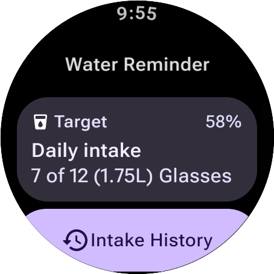
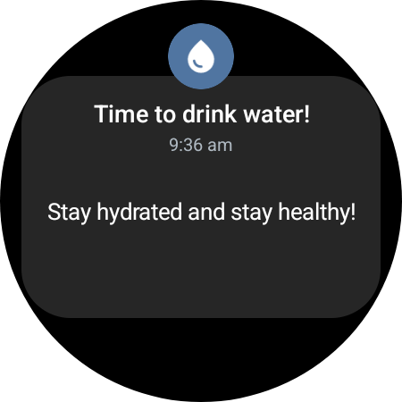
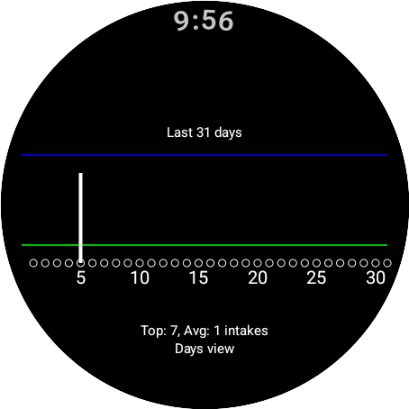
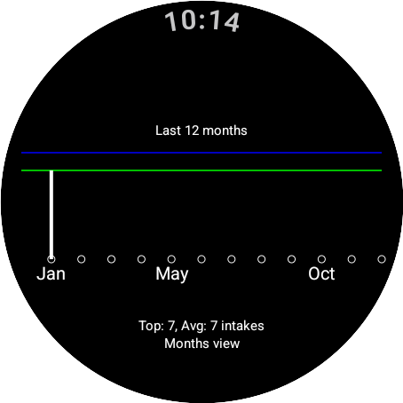
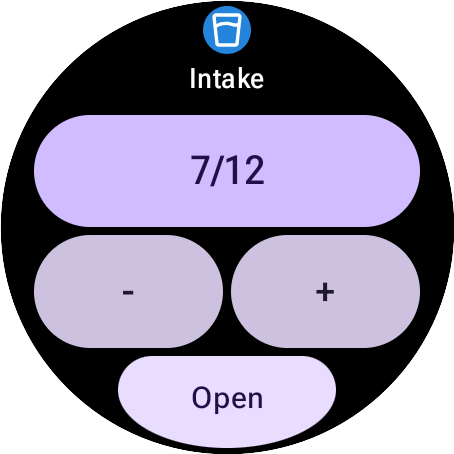
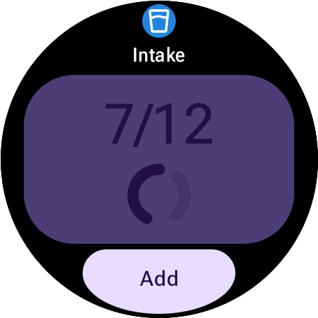
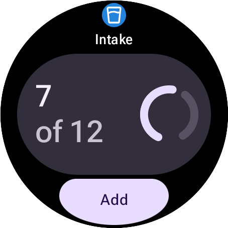

# Rappel d'Hydratation

Rappel d'Hydratation, conçue pour les montres connectée sous `wear-os` en
utilisant la technologie `jetpack compose`, vous aide chaque jour à rester `hydraté`.

Vous recevrez des `notifications` de `08:00 à 22:59` directement sur votre
montre sans avoir besoin de quelconque connexion à votre smartphone, ni
d'avoir à regler des alarmes manuellement.

**[Français][fr]** - [English][en]

## Fonctionalités

- [x] Material 3 Expressive
- [x] Notification intégrée depuis la montre
- [x] Configuration de la fréquence de notification (1h, 3h, désactivé)
- [x] De jolies cartes pour une interaction simple sans ouvrir l'application
- [x] Import/export feature (communicate with http server locally)
- [x] Possibilité d'importer et d'export vos données (en untilisant un
      utilitaire local)
- [x] Quelques astuces d'hydratation

## Pour commencer

> [!NOTE]
> `Télécharger` l'application sur la page `release` de ce dépôt github.

> [!WARNING]
> L'ancienne fonctionalité d'import/export de vos données sera supprimée bientôt
> en faveur de cet utilitaire [Tui \& Cli](https://github.com/RomaricKc1/water_reminder-backup_restore.git).
> Pour utiliser la nouvelle fonctionalité, il vous suffira de télécharger l'outil
> (disponible également dans la page `release` de ce dépôt), le lancer avec les
> l'addresse et le port approprié, et vous laisser guider dans l'application sur
> votre montre. Il est possibile de changer l'`endpoint` pour y mettre l'addresse
> de votre serveur local.

### Procedure d'installation

Il existe multiples methodes d'installer une application sur les montres sous
wear os. Voici la methode que j'utilise:

> [!IMPORTANT]
> Le `Débogage sans fil` doit être activé pour cette procédure. Vous pouvez
> facilement l'activé dans les paramètres de developpeurs dans les paramètres.

```bash
# appareillez et connectez votre montre à votre ordinateur
adb pair [ADDRESSE_IP_MONTRE]:[PORT_APPAREILLAGE] [CODE_APPAREILLAGE]
adb connect [ADDRESSE_IP_MONTRE]:[PORT_DE_CONNEXION]
# pour confirmer que ça a marché
adb devices
# vous devriez voir votre montre listée
# maintenant, reste plus qu'à installer l'application
adb install -r chemin/vers/l'applicationapp.apk
```

et `voilà`!

## Captures d'écran

|                        Home                        |                        Notification                         |                        Historique jours                         |                         Historique mois                          |                            Tile détaillé                             |                         Tile zen                         |                        Tile objectif                         |
| :------------------------------------------------: | :---------------------------------------------------------: | :-------------------------------------------------------------: | :--------------------------------------------------------------: | :------------------------------------------------------------------: | :------------------------------------------------------: | :----------------------------------------------------------: |
|  |  |  |  |  |  |  |

Vous trouverez plus d'images dans le dossier [`./img`](./img/).

[en]: README.md
[fr]: README.fr.md
